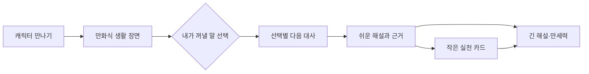

# CR-026 — 이야기로 이해하고 근거까지 읽는 사주

## 사용자 문제와 바뀐 경험

기존 풀이는 용어와 짧은 생활 예시에 그쳤고, 설명을 길게 읽어도 첫 화면부터 전문 용어가 많아 이해하기 어려웠다. 개인 풀이의 기본 진입을 캐릭터가 안내하는 다섯 장면으로 바꿨다. 상세 설명을 삭제하지 않고 별도의 읽기 방식에 유지했다.

| 단계 | 사용자가 보는 것 | 동작 |
| --- | --- | --- |
| 만나기 | 일주에서 정한 동물과 쉬운 이야기 제목 | 일·공부 / 가까운 사람 / 앞으로의 계획 선택 |
| 생활 장면 | 상황 컷과 안내 캐릭터 컷, 말풍선 | 두 가지 대사 중 하나 선택 |
| 내 선택 | 선택한 말, 그 방식의 장점과 살펴볼 점, 실제 대화 예문 | 이전 장면에서 다른 선택도 가능 |
| 이야기 풀이 | 어려운 용어 없이 풀어 쓴 관점과 생활 설명 | 근거를 펼치면 실제 자리·글자·십성 확인 |
| 작은 실천 | 이야기와 연결된 선택 가능한 행동 카드 | 고르기/취소, 다시 보기, 긴 해설로 이동 |

모든 개인 풀이와 내 기질에 `이야기로 보기` / `자세한 풀이·만세력` 전환을 제공한다. 첫 화면은 이야기이고, 긴 해설은 사용자가 선택했을 때 표시한다. 두 방식 사이를 이동해도 같은 조회 조건 안에서는 이야기 진행을 유지한다. 날짜·대운·출생 원국이 달라지면 이전 장면과 선택을 초기화한다. 실천을 고른 것은 실제 수행 완료를 의미하지 않는다.

## 실제 계산과 창작 장면의 경계

- 원국의 일·공부 장면은 **월주 천간의 십성**, 가까운 관계는 **일지 대표 지장간의 십성**, 앞으로의 계획은 **시주 천간의 십성**에 연결한다.
- 출생시간 미상은 원국의 계획 장면을 비활성화하고 이유를 안내한다. 가상의 시주를 만들지 않는다.
- 일/월/연/대운에서는 원국 일간을 기준으로 계산한 해당 운의 천간·지지 관계를 사용한다. 하루의 선택 / 반복되는 생활 / 한 해의 방향 / 선택한 긴 구간으로 시간 맥락을 구별한다.
- 계산되지 않은 기간, 잘못된 날짜, 선택하지 않은 대운 기준에는 운의 이야기를 만들지 않는다. 절기 경계의 영향을 받는 장면은 처음부터 안내한다.
- 십성 10종에 서로 다른 생활 장면과 두 갈래 대사를 새로 작성했다. 선택은 **다음 대사만 바꾼다**. 성격·운세를 재판정하거나 오행·십성·신살 계산을 바꾸지 않는다. 점수·등급·보상·과금 없음.
- 캐릭터 동물은 일지 12종, 기본 색과 이름은 일간 오행에 따른다. 기존 불꽃 원숭이 아트와 나머지 동물의 상징 이모지를 사용했다. 신규 일러스트 완성이나 영상·AI 생성 대화를 주장하지 않는다. 만화 컷과 배경·말풍선은 CSS 구성이다.
- 캐릭터·장면·대사는 이해를 위한 창작 예시다. 실제 미래 사건, 인격, 관계의 안전성을 의미하지 않는다.

## 상세 설명의 깊이

| 대상 | 설명 내용 |
| --- | --- |
| 원국 / 내 기질 | 일간·일주의 차이, 월주와 일지의 일/관계 맥락, 네 기둥의 실제 글자와 십성, 시주의 계획 관점, 오행 분포와 한계, 실제 성립한 합충 |
| 십성 10종 | 산출 원리, 해당 자리의 의미, 일·공부, 가까운 관계, 균형과 실천, 같은 십성이 있는 원국 위치 |
| 일월연대운 | 기간의 범위, 천간·지지의 각각의 관계, 생활 예시, 원국에서 같은 십성이 있는 위치, 실제 합충, 돌아볼 질문 |
| 신살 19종 | 쉬운 긴 설명, 실제 위치와 그 자리의 십성, 일/관계 예시, 같은 자리에 있는 신살, 다른 자리의 같은 신살, 기준과 한계 |
| 실제 신살 조합 | 양쪽 위치와 간지, 서로 다른 생활 맥락, 일과 관계의 연결 예시, 실천 순서, 각각의 근거 |
| 합충 | 실제 글자 쌍, 두 자리의 맥락, 함께 놓고 읽는 의미, 실천 순서 |

상세 원고는 앞선 CR025의 산출 규칙을 유지한다. 신강약·용신·조후·지장간 전체를 새로 계산했다고 표현하지 않는다. 신살의 공존을 새로운 합충이나 상쇄 법칙으로 바꾸지 않는다. 실제로 성립하지 않은 조합을 만들어 문장을 채우지 않는다. 오행의 보이는 개수를 성격의 강도·능력 점수로 사용하지 않는다.

합성 출생정보로 브라우저에서 펼친 내용은 원국 약 3,600자, 일운 약 2,800자, 개별 십성 약 1,400자, 신살 약 1,500자, 조합 약 1,000자였다. 이는 특정 가상 입력의 화면 텍스트 길이이며 모든 입력의 최소 분량 보장이 아니다. 문장 길이 대신 실제 근거와 위치의 변화, 기간별 맥락, 다른 선택의 대사를 검증한다.

## 개인정보와 접근성

새 데이터베이스, 외부 생성 API, 저장·로그·전송 기능을 추가하지 않았다. 출생정보·선택·실천 표시는 브라우저 메모리에서만 사용하며 공개 체험을 새로고침하면 예시값으로 돌아간다. 실제 로그인 프로필의 기존 저장 방식은 변경하지 않았다.

키보드로 선택하고 이동할 수 있고, 장면 전환 후 제목으로 포커스를 옮긴다. 시간 제한·자동 진행·타이핑 대기는 없다. 작은 동작 효과는 `prefers-reduced-motion`을 존중한다. 360/390/430px에서 긴 문장과 만화 컷의 가로 넘침을 검사한다. 상세 설명 전체 펼치기/접기와 개별 항목 열기를 지원한다.

## 검증 범위

- 단위: `readingNarrative.test.ts`의 실제 위치/기간/불확실성/한국어 조사, `readingStory.test.ts`의 장면별 실제 십성·10종 대사·미상/기간 없음 처리·원국 불변.
- 새 브라우저: `verify-reading-story.mjs` 4시나리오(5단계·두 대사·키보드·근거·다시 보기·선택 유지/초기화·날짜/대운·캐릭터·미상·경계·모션·저장 없음), `verify-detailed-readings.mjs` 5시나리오(확장 해설·개인화·실제 조합·기간별 차이·오류/미상/경계).
- 기존 검사: `verify-shinsal`, `verify-trial-profile`, `verify-trial`, `verify-reading`의 원래 검증을 유지하면서 상세 보기 버튼을 통해 진입하도록 갱신. 기존 십성 개수·날짜 변경·알림 등의 단언을 삭제하지 않음.
- 모든 브라우저 검사는 합성 입력을 사용하고 외부 요청을 차단한다. 캡처 없음. 공개 Pages 호스트 직접 탐색과 로컬 배포 빌드 검증은 구분해 기록한다.

테스트 사이트 배포는 기존 사용자 승인 범위. main merge, 운영 SQL, 실제 결제, 외부 메시지 발송, 유료 사용 없음.

2026-10-16 검증 결과: 단위 27파일 228검사, lint, production build 통과. 개발 브라우저 40시나리오와 배포 빌드 브라우저 23시나리오 통과. 기존 큰 번들 경고는 남아 있다(주 JS 758.94 kB, gzip 233.99 kB). 상세 원고 추가로 초기 전송량이 늘었으며 실제 모바일 네트워크 성능 측정은 수행하지 않았다.
